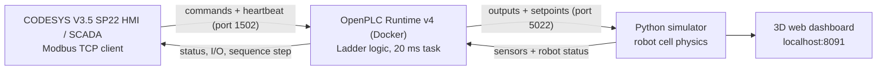

# Robotic Packing Cell: OpenPLC + CODESYS HMI + Python Digital Twin


A three-layer industrial automation project modelled on a real factory. A robot with a vacuum gripper picks products from an infeed conveyor, a camera inspects each one, and the robot places good products into cartons and drops defective ones into a reject bin. Full cartons are released onto a take-away conveyor.

- **OpenPLC** runs the control logic in ladder diagram (LD).
- **CODESYS** provides the operator HMI/SCADA and is the main control station.
- **A Python simulator** acts as the physical plant. It is a digital twin with a live 3D dashboard.

All three layers talk to each other over **Modbus TCP**, the same way a real PLC talks to remote I/O and to a SCADA system.

---

## Highlights

- **Real PLC architecture.** The simulator only acts and measures, and every decision is made by the PLC program.
- **Step sequencer in ladder logic.** It runs a 10-step cycle: infeed → inspect → pick → grip → place/reject → release → carton change.
- **Robot controller handshake.** The PLC and the robot use `TARGET` / `GO` / `BUSY` / `DONE` / `FAULT` / `RESET`, like an industrial robot interface.
- **Machine vision check.** The camera reports pass/fail plus a defect code: dent, missing label or wrong colour.
- **Local / Remote control.** A key switch selects the control place. In REMOTE the CODESYS HMI is in charge, guarded by a **heartbeat watchdog**. Local STOP and E-STOP always work.
- **Random factory events.** Vacuum loss, slow camera, supply gaps, belt slips, guard-door openings and robot servo faults happen on their own, like on a real line.
- **3D digital twin dashboard** (Three.js). It shows live I/O, production KPIs, quality results and an event log.
- **Built-in quality scoring.** The simulator knows the truth about every product, so it counts PLC mistakes: bad products packed, good products rejected, double placements and short cartons.

---

## System Architecture



| Layer | Software | Role |
|---|---|---|
| Level 2: Supervisory | CODESYS V3.5 SP22 Patch 2 + Control Win V3 x64 | HMI / SCADA, remote START / STOP / RESET, process data |
| Level 1: Control | OpenPLC Editor 4.3 + OpenPLC Runtime v4 (Docker) | Ladder logic: sequencing, interlocks, safety, command arbitration |
| Level 0: Field | Python 3 (standard library only) | Robot, conveyors, camera, vacuum and cartons, exposed as Modbus remote I/O |


### Network ports

| Port | Service | Client |
|---|---|---|
| `5022` | Simulator Modbus TCP server (remote I/O) | OpenPLC (master) |
| `8091` | Simulator web dashboard | Browser |
| `1502` | OpenPLC Modbus TCP server | CODESYS |
| `8443` | OpenPLC Runtime web interface | OpenPLC Editor / browser |
| `8080` | CODESYS WebVisu | Browser |

---

## Repository Structure

```
├── RobotSimulator/                 Plant simulator (digital twin)
│   ├── robot_io.py                 Modbus TCP server and I/O lists (FC2/4/6/15/16)
│   ├── robot_server.py             Cell physics, random events, HTTP API
│   ├── robot_view.html             3D dashboard (Three.js)
│   ├── robot_view_classic.html     2D top view, available at /classic
│   └── Start Robot.bat             One-click start (Windows)
├── RobotCell/                      OpenPLC Editor project
│   ├── project.json
│   ├── devices/remote/RobotIO.json   Modbus master → simulator
│   ├── devices/servers/HMI.json      Modbus server for the HMI
│   └── pous/programs/main.ld         Main ladder program (51 rungs)
└── RobotCellHMI/
    └── RobotCellHMI.project        CODESYS HMI project
```

---

## Requirements

- Windows 10/11
- [Python 3.10+](https://www.python.org/). No extra packages are needed.
- [Docker Desktop](https://www.docker.com/products/docker-desktop/)
- [OpenPLC Editor 4.3](https://autonomylogic.com/) with OpenPLC Runtime v4
- [CODESYS V3.5 SP22 Patch 2](https://store.codesys.com/) with **CODESYS Control Win V3 x64**. The demo runtime runs for 2 hours per start.
- An internet connection for the 3D dashboard, which loads Three.js from a CDN

> **Tip:** Keep the projects in a plain path such as `C:\PLC Project\`. Paths with non-ASCII characters or inside OneDrive can break the OpenPLC build.

---

## Getting Started

### 1. Start the simulator

Double-click **`RobotSimulator/Start Robot.bat`**, or run:

```bash
cd RobotSimulator
python robot_server.py
```

The dashboard opens at **http://localhost:8091**. The simulator listens for the PLC on Modbus port **5022**.

### 2. Start OpenPLC Runtime (Docker)

On first use, create the container:

```bash
docker run -d --name openplc-runtime -p 8443:8443 -p 1502:1502 --cap-add=SYS_NICE --cap-add=SYS_RESOURCE -v openplc-runtime-data:/var/run/runtime ghcr.io/autonomy-logic/openplc-runtime:latest
```

After that, start it with:

```bash
docker start openplc-runtime
```

### 3. Load the PLC program

1. Open the `RobotCell` folder in **OpenPLC Editor**.
2. **Build & Upload** to the runtime at `127.0.0.1`, then press **Play**.
3. The simulator dashboard should show **PLC connected**.

> The remote device `RobotIO` points to `host.docker.internal:5022` because the runtime runs inside Docker. If you run OpenPLC natively, change it to `127.0.0.1`.

### 4. Start the CODESYS HMI

1. Start **CODESYS Control Win V3 x64**: right-click the system tray icon → **Start PLC**.
2. Open `RobotCellHMI/RobotCellHMI.project`.
3. Set your PC's IP address in two places:
   - **Ethernet** adapter
   - **OpenPLC** Modbus TCP server device: port `1502`, **Unit-ID `1`**
4. **Login** (download), then **Start** (F5).
5. Open the WebVisu at **http://localhost:8080/webvisu.htm**.

### 5. Run the cell

1. In the simulator dashboard, turn the key switch to **REMOTE**.
2. Press **START** on the CODESYS HMI.
3. The robot begins picking, inspecting and packing.

---

## How It Works

### Production sequence (`SEQ_STEP`)

| Step | State | Action | Next when |
|---|---|---|---|
| 0 | Idle | Wait for the machine to start | `MACHINE_ON` |
| 10 | Infeed | Run the infeed conveyor | `PRODUCT_AT_PICK` |
| 20 | Inspect | Trigger the camera and store pass/fail | `CAMERA_DONE` |
| 30 | To pick | Robot → position 1 | `ROBOT_DONE` |
| 40 | Grip | Vacuum on | `VACUUM_OK` |
| 50 | Place / reject | Good → carton slot `SLOT + 11`, bad → position 20 | `ROBOT_DONE` |
| 60 | Release | Vacuum off for 300 ms; count the slot if good | Timer done |
| 70 | Decide | Check whether the carton is full (`SLOT ≥ PATTERN`) | Not full → 10, full → 80 |
| 80 | Carton out | Run the outfeed and release the full carton | `NOT CARTON_AT_PACK` |
| 90 | Carton in | Bring the next empty carton and reset `SLOT` | `CARTON_AT_PACK` → 10 |

The program follows a structured ladder pattern: **step decoders** (`EQ SEQ_STEP → S0…S90`), then **transitions** (`MOVE` to the next step), then **outputs**.

### Robot handshake

1. The PLC writes `ROBOT_TARGET` and raises `ROBOT_GO`.
2. The robot sets `ROBOT_BUSY` at once and reads the target 0.2 s later.
3. On arrival it sets `ROBOT_DONE`, which stays on until the PLC drops `ROBOT_GO`.
4. After a fault, a `ROBOT_RESET` pulse clears it. If `GO` is still on, the robot resumes the move.

| Position | Meaning |
|---|---|
| `0` | Home |
| `1` | Pick (infeed stop) |
| `11–19` | Carton slots 1–9, row by row from the top-left |
| `20` | Reject bin |

The carton pattern can be 4 (2×2), 6 (3×2) or 9 (3×3). The default is 6. Robot speed is 50 %.

### Local / Remote control and safety

| Command | Logic |
|---|---|
| `START_CMD` | `(PB_START AND NOT SEL_REMOTE) OR (HMI_START AND SEL_REMOTE AND HMI_OK)` |
| `STOP_CMD` | `PB_STOP OR (HMI_STOP AND SEL_REMOTE) OR (SEL_REMOTE AND NOT HMI_OK)` |
| `RESET_CMD` | `(PB_RESET AND NOT SEL_REMOTE) OR (HMI_RESET AND SEL_REMOTE)` |

- **Heartbeat watchdog:** the HMI toggles `HMI_HEARTBEAT` every second. If it stays unchanged for 3 s, `HMI_OK` drops and the machine stops in REMOTE.
- The **local STOP** button and the **E-STOP** work in every mode.
- The E-STOP latches a robot fault that needs a RESET.
- Opening the **guard door** pauses the robot.

**Stack light:** green = running · amber = guard door open · red = E-stop or robot fault.

---

## I/O Map

### Simulator ↔ OpenPLC (remote device `RobotIO`, port 5022)

**Discrete inputs (FC2), simulator → PLC**

| Address | Signal | Address | Signal |
|---|---|---|---|
| `%IX0.0` | ESTOP_OK | `%IX1.1` | ROBOT_READY |
| `%IX0.1` | DOOR_CLOSED | `%IX1.2` | ROBOT_BUSY |
| `%IX0.2` | PB_START | `%IX1.3` | ROBOT_DONE |
| `%IX0.3` | PB_STOP | `%IX1.4` | ROBOT_AT_HOME |
| `%IX0.4` | PB_RESET | `%IX1.5` | ROBOT_FAULT |
| `%IX0.5` | SEL_REMOTE | `%IX1.6` | VACUUM_OK |
| `%IX0.6` | PRODUCT_AT_PICK | `%IX1.7` | CARTON_AT_PACK |
| `%IX0.7` | CAMERA_DONE | `%IX2.0` | CARTON_OUT (0.5 s pulse) |
| `%IX1.0` | CAMERA_PASS | | |

**Input registers (FC4), simulator → PLC**

| Address | Signal | Notes |
|---|---|---|
| `%IW0` | ROBOT_POS | Current position number (99 = moving) |
| `%IW1` | ROBOT_ANGLE | Degrees |
| `%IW2` | ROBOT_REACH | mm |
| `%IW3` | CAMERA_CODE | 0 good · 1 dent · 2 no label · 3 wrong colour · 9 no product |

**Coils (FC15), PLC → simulator**

| Address | Signal | Address | Signal |
|---|---|---|---|
| `%QX0.0` | INFEED_RUN | `%QX0.6` | VACUUM_ON |
| `%QX0.1` | OUTFEED_RUN | `%QX0.7` | LAMP_GREEN |
| `%QX0.2` | CAMERA_TRIGGER | `%QX1.0` | LAMP_AMBER |
| `%QX0.3` | ROBOT_ENABLE | `%QX1.1` | LAMP_RED |
| `%QX0.4` | ROBOT_GO | `%QX1.2` | BUZZER |
| `%QX0.5` | ROBOT_RESET | | |

**Holding registers (FC16), PLC → simulator**

| Address | Signal | Range |
|---|---|---|
| `%QW0` | ROBOT_TARGET | 0, 1, 11–19, 20 |
| `%QW1` | ROBOT_SPEED | 10–100 % |
| `%QW2` | PATTERN | 4, 6 or 9 |

### OpenPLC ↔ CODESYS (OpenPLC Modbus server, port 1502, Unit-ID 1)

Buffer mapping: coils = 16 × `%QX` + 32 × `%MX`; holding registers = 16 × `%QW` + 32 × `%MW`.

| CODESYS channel | Function | Offset / Length | CODESYS address | Content |
|---|---|---|---|---|
| Sensors | FC2 Read Discrete Inputs | 0 / 17 | `%IX0.0–%IX2.0` | All field inputs |
| RobotData | FC4 Read Input Registers | 0 / 4 | `%IW2–%IW5` | Robot position, angle, reach, camera code |
| Outputs | FC1 Read Coils | 0 / 48 | `%IB12–%IB17` | PLC outputs and memory bits |
| Numbers | FC3 Read Holding Registers | 0 / 33 | `%IW9–%IW41` | Target, speed, pattern, `SEQ_STEP`, `SLOT` |
| Commands | FC15 Write Multiple Coils | 16 / 10 | `%QX0.0–%QX1.1` | HMI commands |

| HMI command | Modbus coil | OpenPLC address |
|---|---|---|
| HMI_START | 16 | `%MX0.0` |
| HMI_STOP | 17 | `%MX0.1` |
| HMI_RESET | 18 | `%MX0.2` |
| HMI_HEARTBEAT | 24 | `%MX1.0` |

| Process value | Holding register | OpenPLC address |
|---|---|---|
| SEQ_STEP | 27 | `%MW11` |
| SLOT | 28 | `%MW12` |

In CODESYS, the GVL **`Cell`** maps every signal with `AT` declarations. The GVL **`Cmd`** holds the HMI commands. `PLC_PRG` stretches each button press into a 500 ms pulse and toggles the heartbeat every second.

---

## Random Factory Events

While the machine runs, the simulator injects realistic disturbances one at a time. Choose the mode in the dashboard or with `--events`.

| Event | Effect |
|---|---|
| Vacuum pressure low | The gripper cannot hold the product for a few seconds |
| Camera slow | Image processing is delayed |
| Upstream supply gap | No new products arrive for a while |
| Infeed belt slipping | The infeed stops moving briefly |
| Carton conveyor stalled | The outfeed stops moving briefly |
| Guard door opened | A technician opens the door and the robot pauses |
| Robot servo overload | The robot faults and needs a **RESET** |
| Product slip *(stress only)* | The product falls off the gripper during a move |

| Mode | Defect rate | Event frequency |
|---|---|---|
| `off` | 5 % | No events |
| `realistic` (default) | 10 % | Normal |
| `stress` | 20 % | 3× more often |

Operators also tidy up by themselves: the reject bin is emptied at 12 products, and dropped products are picked up after 25 s.

---

## Simulator Options

```bash
python robot_server.py [--events off|realistic|stress] [--defect-rate PCT]
                       [--spawn SECONDS] [--port MODBUS_PORT]
                       [--web-port WEB_PORT] [--no-browser]
```

| Option | Default | Description |
|---|---|---|
| `--events` | `realistic` | Random factory event mode |
| `--defect-rate` | set by mode | Percentage of products with a defect |
| `--spawn` | `2.5` | Seconds between new products |
| `--port` | `5022` | Modbus TCP port |
| `--web-port` | `8091` | Dashboard port |
| `--no-browser` | off | Don't open the browser automatically |

The old 2D view is available at **http://localhost:8091/classic**.

---

## Troubleshooting

| Symptom | Fix |
|---|---|
| Dashboard shows **PLC not connected** | Start Docker Desktop and the `openplc-runtime` container, then press **Play** in OpenPLC |
| `Port 5022 is already in use` | Another simulator window is still running. Close it and start again |
| HMI buttons do nothing | Turn the simulator key switch to **REMOTE**. It returns to LOCAL every time the simulator restarts |
| CODESYS shows no Modbus values | Check that the server device **Unit-ID is 1**, the IP matches your PC, and *Always update variables* is enabled |
| CODESYS stops after 2 hours | Demo runtime limit. Restart it from the system tray (**Start PLC**) |
| OpenPLC build fails (`OpenPLCUserLib.h` not found) | Move the project to a path without non-ASCII characters (not inside OneDrive) |
| 3D view stays empty | The dashboard needs internet access for Three.js. Use `/classic` offline |

---

## Roadmap

- [ ] Machine states and modes (Stopped / Idle / Running / Held / Faulted)
- [ ] Alarm handling with timeouts and a CODESYS Alarm Manager page
- [ ] Manual (jog) page and recipe selection (pattern, speed, batch size)
- [ ] Production counters, trends and user login on the HMI
